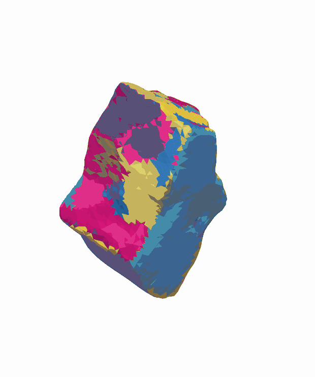
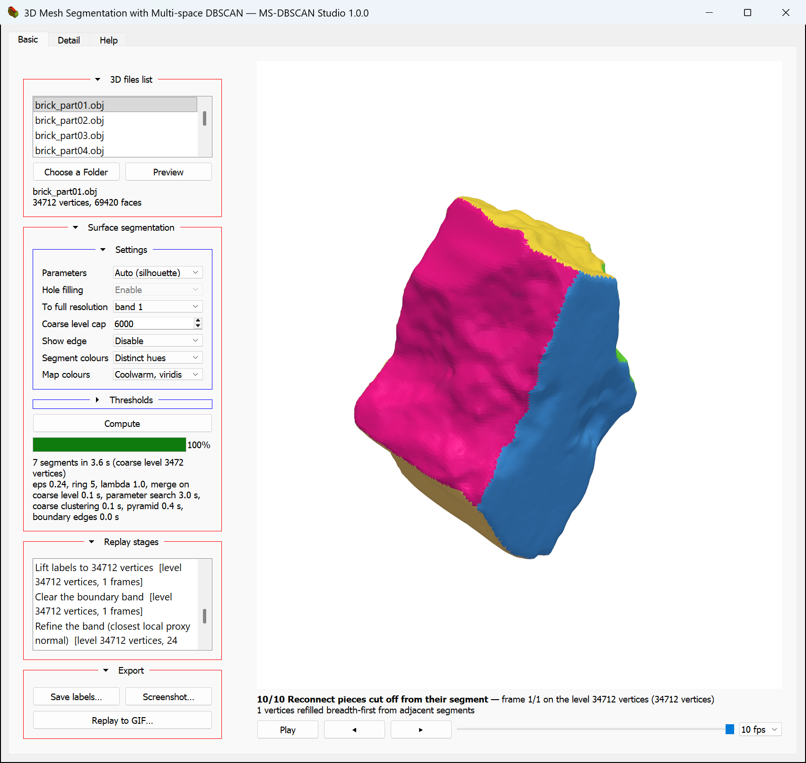
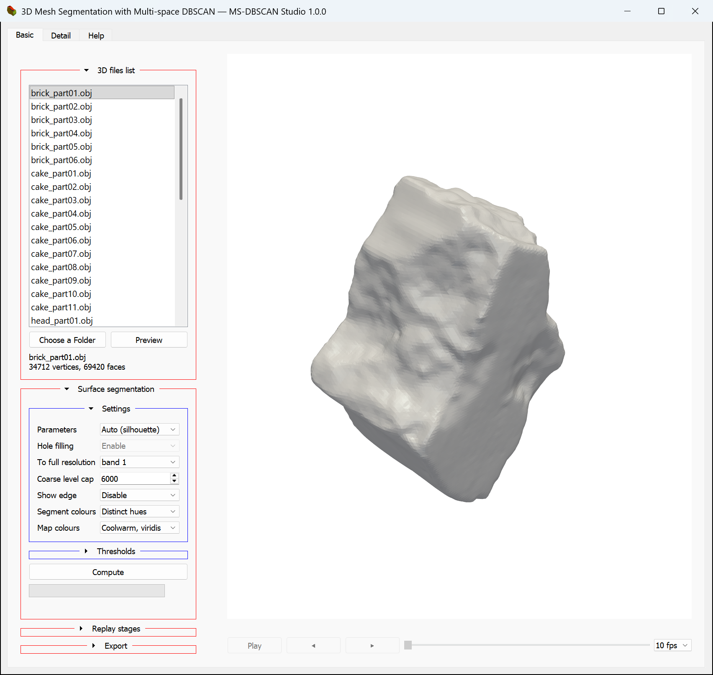
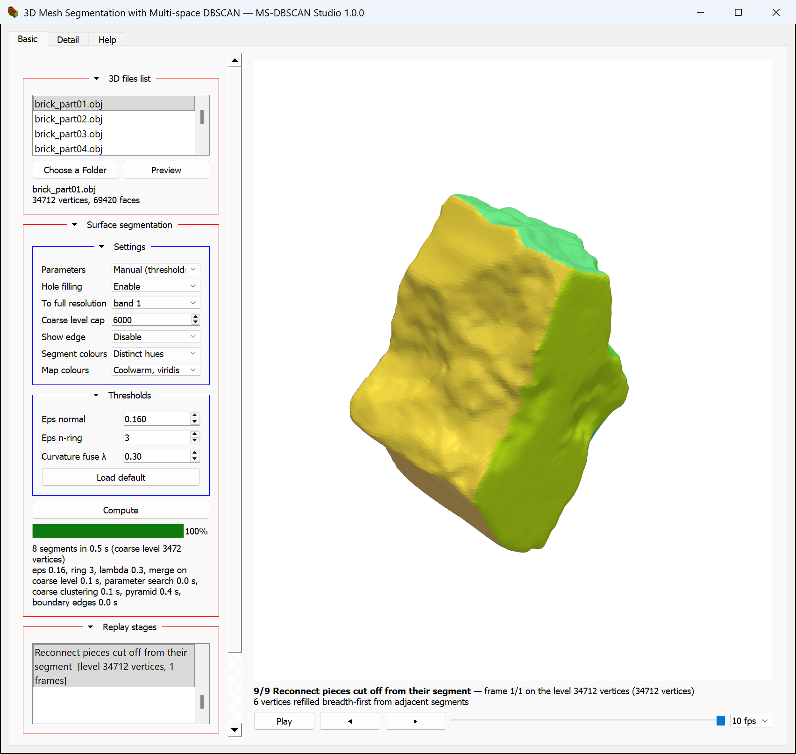
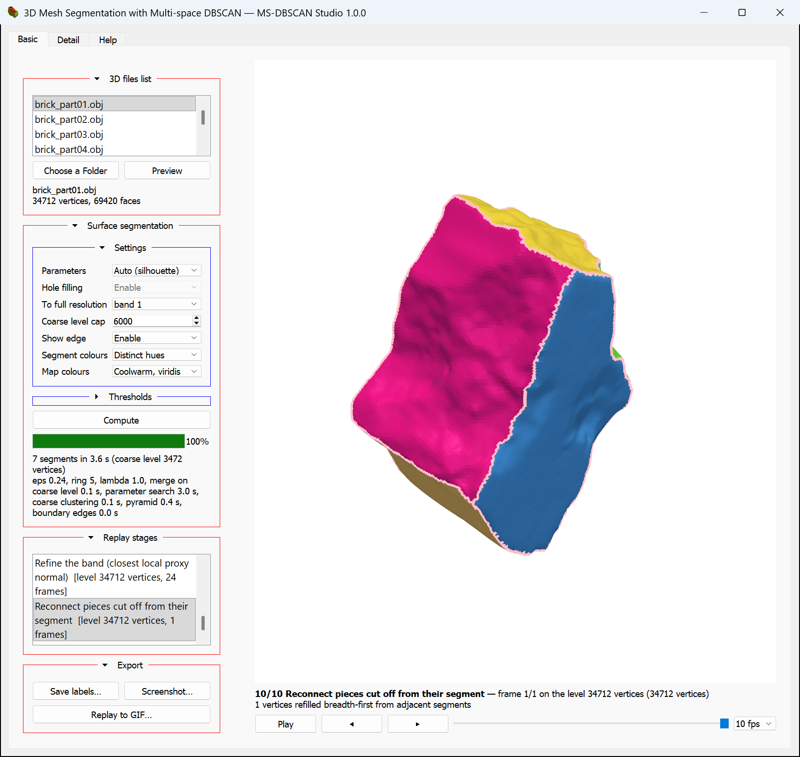
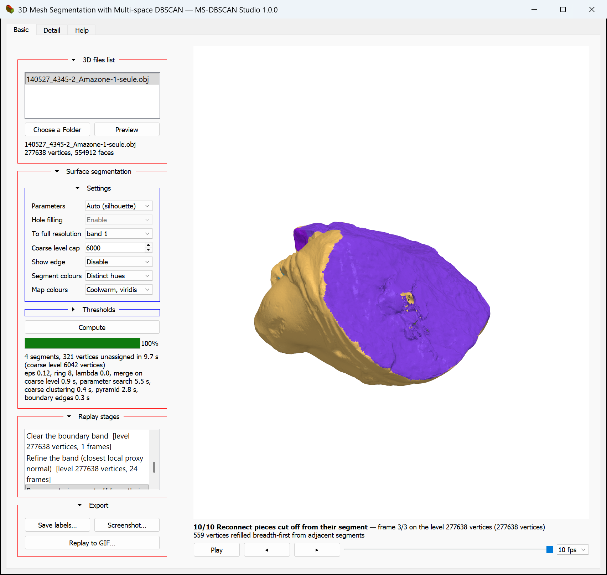
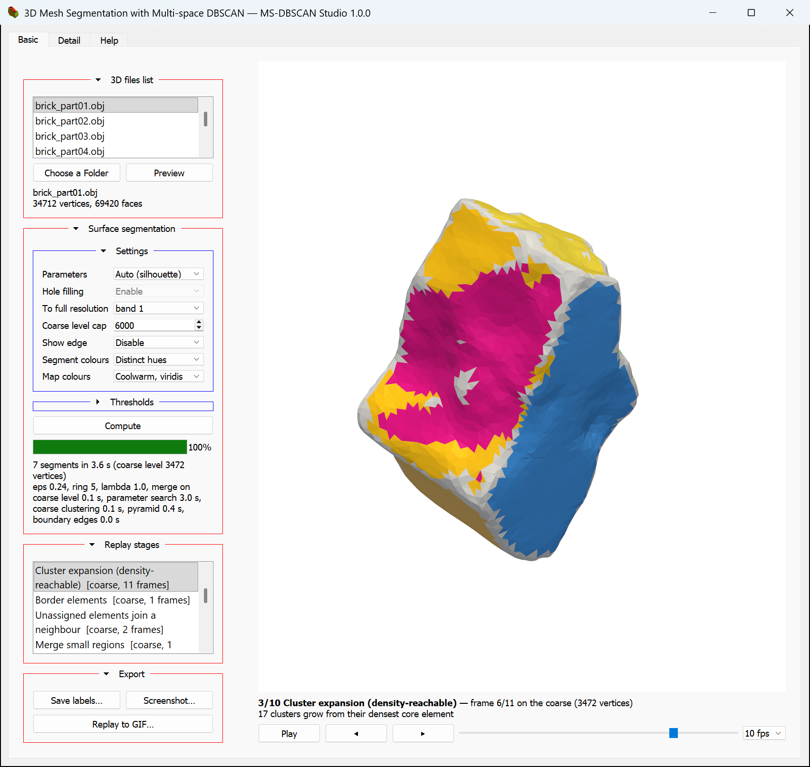
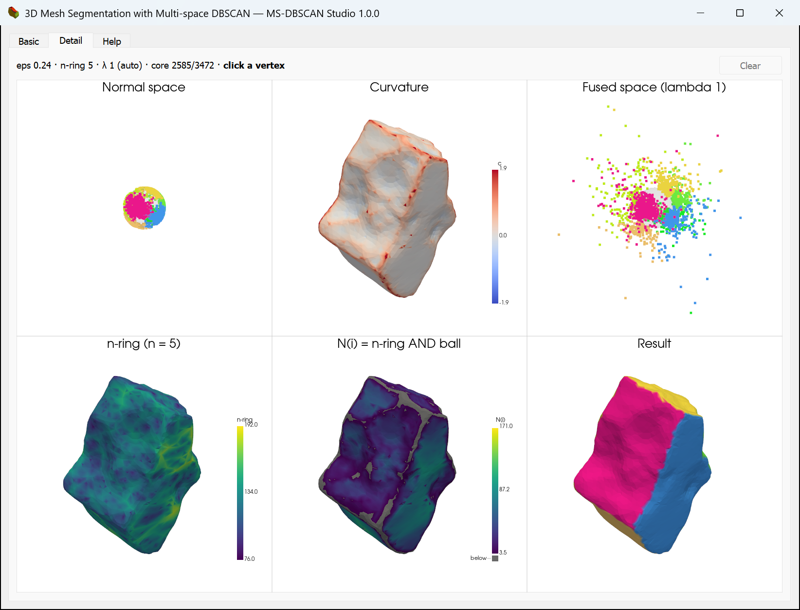
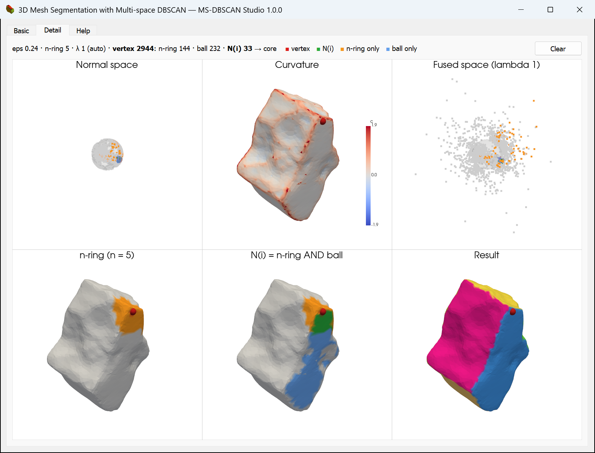

# MS-DBSCAN Studio

**Segment rough 3D surfaces with Multi-space DBSCAN, and see how every segment is formed.**

MS-DBSCAN Studio is a desktop application for segmenting triangle meshes into surface regions. It is the
remastered software of the MS-DBSCAN project, published in *Multimedia Tools and Applications* (MTAP, 2025).
It runs on meshes of any size, can choose its parameters per mesh, replays the clustering step by step, and
shows the normal, curvature and neighbourhood spaces the method combines.

<p align="center">
  
</p>

> [!IMPORTANT]
> Studio uses an extended algorithm (MS-DBSCAN v2-fuse with a coarse-to-fine pyramid), which **is not the
> configuration evaluated in the paper**. To reproduce the paper, use the
> [original application](#original-application-mtap-2025), which is kept unchanged in this repository.

## Contents

- [What is new](#what-is-new)
- [Repository layout](#repository-layout)
- [Installation](#installation)
- [Quick start](#quick-start)
- [User guide](#user-guide)
  - [1. Load a mesh](#1-load-a-mesh)
  - [2. Segment](#2-segment)
  - [3. Replay the segmentation](#3-replay-the-segmentation)
  - [4. Inspect the spaces (Detail tab)](#4-inspect-the-spaces-detail-tab)
  - [5. Export the result](#5-export-the-result)
- [Parameter reference](#parameter-reference)
- [How the method works](#how-the-method-works)
- [Scripting](#scripting)
- [Datasets](#datasets)
- [Known limitations](#known-limitations)
- [Troubleshooting](#troubleshooting)
- [Building a release](#building-a-release)
- [Original application (MTAP 2025)](#original-application-mtap-2025)
- [Citation](#citation)

## What is new

| | Original application (paper) | MS-DBSCAN Studio |
|---|---|---|
| **Clustering** | MS-DBSCAN as released | MS-DBSCAN v2-fuse: canonical DBSCAN semantics, independent of vertex order |
| **Curvature** | Separate threshold (*Eps curvature*) | Fused into the normal space with one weight λ, which can be 0 |
| **Parameters** | Set by hand | *Auto*: best of 60 configurations × hole filling off/on, by silhouette, without ground truth. *Manual* remains available |
| **Mesh size** | Works on the simplified mesh | Clusters a coarse level, then carries the labels to the full mesh |
| **Inspection** | Normal sphere, curvature map, result | Step-by-step replay and a *Detail* tab with one panel per space |
| **Interface** | Computation in the window thread | Computation in a worker thread, so the window stays responsive |
| **Export** | One `.ply` per segment, thresholds to `.csv` | Labels to `.npz`, view to `.png`, replay to `.gif` |

## Repository layout

```
MS-DBSCAN/
├── app/                    MS-DBSCAN Studio
│   ├── msdbscan_studio.py    the application
│   ├── README.md             full reference, shown in the Help tab
│   ├── build_release.py      PyInstaller build and frozen self-test
│   └── build_linux.sh        Linux build
├── src/msdbscan/           clustering, pyramid and mesh code
├── docs/images/            screenshots of this guide
├── evaluation_dataset/     meshes for testing, with ground truth for two datasets
├── original_dataset/       the same models in their original formats
├── legacy/original_app/    the application published with the paper
└── requirements.txt        pinned runtime dependencies
```

## Installation

### Option A: pre-built application (no Python needed)

Download the archive for your system from the [Releases page](https://github.com/nam-usth/MS-DBSCAN/releases).

| System | Archive | Requirements |
|---|---|---|
| Windows | `MSDBSCAN-Studio-1.0.0-windows-x64.zip` (165 MB) | Windows 10 or 11, 64-bit |
| Linux | `MSDBSCAN-Studio-1.0.0-linux-x64.tar.gz` (227 MB) | 64-bit, glibc 2.35 or newer (Ubuntu 22.04, Debian 12 or later), X11 or Wayland, OpenGL |

**Windows:** unzip the archive and run `MSDBSCAN-Studio.exe`.

**Linux:**

```bash
tar -xzf MSDBSCAN-Studio-1.0.0-linux-x64.tar.gz
./MSDBSCAN-Studio/MSDBSCAN-Studio
```

### Option B: run from source

Python 3.9 or 3.10 is required. With [Anaconda](https://www.anaconda.com/download), from the repository folder:

```bash
conda create -n ms_dbscan python=3.10
conda activate ms_dbscan
pip install -r requirements.txt
python app/msdbscan_studio.py
```

### Check the installation

The self-test opens the window, segments a 55 896-vertex fragment, exercises the replay, the Detail tab, the
colour settings and the segment boundaries, then closes.

```bash
mkdir selftest_out
python app/msdbscan_studio.py --selftest evaluation_dataset/SIGGRAPH_2006/brick_part06.obj selftest_out/brick_part06.png
```

A correct installation prints a first line starting with:

```
SELFTEST OK stages 10 frames 168 segments 6 unassigned vertices 0
```

## Quick start

1. Start the application.
2. In **3D files list**, press **Choose a Folder** and select `evaluation_dataset/SIGGRAPH_2006`.
3. Double-click `brick_part01.obj`.
4. Leave *Parameters* on **Auto (silhouette)** and press **Compute**.
5. Press **Play** to watch the segmentation being built, or open the **Detail** tab and click a vertex.

## User guide

The window has three tabs. **Basic** holds the control panel and the 3D view, **Detail** shows the spaces of
the method, and **Help** contains the [full parameter reference](app/README.md). Each region of the control
panel folds and unfolds with the arrow before its title.



### 1. Load a mesh

1. In **3D files list**, press **Choose a Folder**. The list shows every `.obj`, `.ply`, `.stl` and `.vtk` file
   in that folder.
2. Select a file and press **Preview**, or double-click it. The file name and its vertex and face counts appear
   under the buttons.
3. Rotate the mesh with the left mouse button and zoom with the wheel.

You can also open a mesh directly from the command line:

```bash
python app/msdbscan_studio.py evaluation_dataset/SIGGRAPH_2006/brick_part01.obj
```



### 2. Segment

Choose how the parameters are set in **Surface segmentation → Settings**, then press **Compute**.

**Auto (silhouette)** is the recommended starting point. On a coarse copy of the mesh, Studio tries 60
threshold configurations, each with and without hole filling, and keeps the result whose segments are best
separated in normal space. No ground truth is used.

**Manual (thresholds)** unfolds the *Thresholds* group. Set *Eps normal*, *Eps n-ring* and *Curvature fuse λ*,
or press **Load default** for 0.16 / 3 / 0.3. These defaults are a starting point and were not selected on data.



When the computation ends, the text under the progress bar reports:

- the number of segments and, if any, the vertices left unassigned;
- the time taken and the size of the coarse level;
- the parameters used, which is how you read what *Auto* chose;
- the time of each step.

To compare results visually, set **Show edge** to *Enable*. This draws the segment boundaries in pink without
recomputing anything.



Large scans follow the same steps. The example below is a 277 638-vertex scan, segmented in Auto mode in about
10 seconds on the development machine. This full-resolution scan is not in the repository, which holds a
27 826-vertex version.



### 3. Replay the segmentation

Every step of the computation is recorded. After **Compute**, the **Replay stages** region lists them.

- **Play / Pause** runs the replay at the speed chosen on the right (5 to 40 fps).
- **◀ / ▶** step one frame, and the slider moves to any frame.
- **Click a stage** to jump to its first frame.

The caption under the view explains the current frame.



| Stage | Level | What you see |
|---|---|---|
| Parameter search | coarse | One frame per candidate, with its parameters and silhouette (Auto only) |
| Core elements | coarse | Gold: vertices with enough neighbours to seed a cluster |
| Cluster expansion | coarse | Clusters grow breadth-first from their densest core vertex |
| Border elements | coarse | Non-core vertices join the core neighbour with the closest normal |
| Unassigned elements join a neighbour | coarse | Remaining vertices are absorbed in breadth-first rounds |
| Merge small regions | coarse | Small pieces join a neighbouring segment (when hole filling is on) |
| Lift labels | full | Each vertex takes the label of the coarse vertex it collapsed into |
| Clear the boundary band | full | Grey: vertices near a boundary, about to be recomputed |
| Refine the band | full | Each band vertex takes the segment with the closest local normal |
| Reconnect pieces | full | Pieces cut off from their segment are refilled |

Light grey means *not reached yet* and dark grey means *unassigned*.

### 4. Inspect the spaces (Detail tab)

The **Detail** tab shows, on the coarse level of the last result, every space MS-DBSCAN combines.



| Panel | Shows |
|---|---|
| **Normal space** | The unit normal of each vertex, as a point on the unit sphere |
| **Curvature** | Maximum principal curvature × mean edge length (red convex, blue concave) |
| **Fused space** | Each normal stretched to length 1 + λ·\|c\|, the space in which the ε-ball is taken |
| **n-ring** | How many vertices lie within n edges of each vertex |
| **N(i)** | The size of the DBSCAN neighbourhood, n-ring ∩ ball. Grey vertices are not core, typically on creases |
| **Result** | The segmentation of the coarse level, before it is carried to the full mesh |

**Click a vertex** in any panel to see its neighbourhood in all of them. Dragging rotates the view without
picking, and **Clear** returns to the maps.



| Colour | Meaning |
|---|---|
| 🔴 Red | The selected vertex (with its ε-ball on the spheres) |
| 🟢 Green | N(i): close on the surface **and** in the feature space. These are the neighbours DBSCAN counts |
| 🟠 Orange | Close on the surface only (n-ring) |
| 🔵 Blue | Similar orientation but too far along the surface (ball only) |

### 5. Export the result

The **Export** region unfolds when a result is available.

| Button | Writes |
|---|---|
| **Save labels…** | `.npz` with the mesh, the labels and the parameters |
| **Screenshot…** | `.png` of the 3D view |
| **Replay to GIF…** | Animated `.gif` of the replay (at most 150 frames) |

The `.npz` file contains:

| Key | Content |
|---|---|
| `V`, `F` | Vertices (n × 3) and triangles (m × 3) of the mesh the labels refer to |
| `vertex_labels` | Segment id per vertex, with −1 for unassigned vertices |
| `face_labels` | Segment id per face |
| `params` | JSON string: thresholds, hole filling, transfer mode, coarse cap, source file |

To write one `.ply` file per segment, as the original application did:

```python
import json
from pathlib import Path

import numpy as np
import trimesh

data = np.load("brick_part01_msdbscan.npz")
V, F, labels = data["V"], data["F"], data["face_labels"]
print(json.loads(str(data["params"])))

out = Path("segments")
out.mkdir(exist_ok=True)
for s in np.unique(labels[labels >= 0]):
    part = trimesh.Trimesh(V, F[labels == s], process=False)
    part.remove_unreferenced_vertices()
    part.export(out / f"segment_{int(s):03d}.ply")
```

## Parameter reference

The [Help tab](app/README.md) documents every control in full. The essentials:

| Control | Effect | When to change it |
|---|---|---|
| **Parameters** | *Auto* searches 60 configurations; *Manual* uses the thresholds | Use *Manual* when the Auto result does not match the facets you expect |
| **Hole filling** | Merges small pieces into a neighbouring segment (Manual only; Auto decides) | Disable it to keep small features |
| **To full resolution** | *coarse only*, *lift*, *band 1* (default), *band 2*, *two steps* | *lift* skips the boundary refinement; *band 2* recomputes a wider strip around boundaries |
| **Coarse level cap** | Maximum vertices of the coarse level (default 6000) | Raise it to keep smaller features; each configuration becomes slower |
| **Eps normal** | Radius in normal space | Raise it for fewer, larger segments |
| **Eps n-ring** | Radius along the surface, in edges | Raise it to make more vertices core; clusters can then cross narrow features |
| **Curvature fuse λ** | Weight of curvature (0 = normals only) | A small value mainly separates creases; a large value also splits curved facets |
| **Show edge, Segment colours, Map colours** | Display only | Never change the result |

*Eps normal* is the chord between unit normals, 2·sin(θ/2):

| Eps normal | 0.08 | 0.12 | 0.16 | 0.24 | 0.32 |
|---|---|---|---|---|---|
| Angle θ | 4.6° | 6.9° | 9.2° | 13.8° | 18.4° |

**Tuning by symptom (Manual mode):**

| You see | Try |
|---|---|
| One facet split into many segments | Raise *Eps normal*, or lower λ |
| Two facets merged across a crease | Lower *Eps normal*, or raise λ |
| Clusters leaking through narrow features | Lower *Eps n-ring* |
| Many small fragments | Enable *Hole filling*, or raise *Eps normal* |
| Jagged boundaries on the full mesh | Use *band 1* or *band 2* instead of *lift* |

## How the method works

1. **Coarse level.** The mesh is reduced to 10 % of its vertices and smoothed with 100 Laplacian iterations,
   as in the paper, and capped at 6000 vertices. The map from each original vertex to its coarse vertex is kept.
2. **Parameters.** Chosen per mesh by the area-weighted silhouette of the face normals, or set by hand.
3. **MS-DBSCAN v2-fuse.** The neighbourhood of vertex *i* combines surface proximity and orientation:

   ```
   N(i) = n-ring(i) ∩ { j : ‖rᵢ·nᵢ − rⱼ·nⱼ‖ ≤ Eps normal },    r = 1 + λ·|κ·ē|
   ```

   where *n* is the unit normal, κ the maximum principal curvature and ē the mean edge length. A vertex with at
   least 4 neighbours (MinPts = 5, itself included) is core. Clusters grow through core vertices, and the
   remaining vertices join a neighbouring cluster.
4. **Pyramid.** Labels are lifted to the full mesh through the collapse map. Vertices in a band around each
   boundary are reassigned to the segment with the closest local mean normal, and pieces cut off from their
   segment are refilled.

## Scripting

The pipeline can be called without the interface, for example to process a folder:

```python
import sys
from pathlib import Path

import numpy as np

sys.path.insert(0, "src")
from msdbscan.meshio import load_obj
from msdbscan.pipeline import segment

for path in sorted(Path("evaluation_dataset/SIGGRAPH_2006").glob("brick_part0[1-2].obj")):
    mesh = load_obj(str(path))
    result = segment(mesh.V, mesh.F)  # Auto; pass params=dict(eps_normal=0.16, n_ring=3, fuse_lambda=0.3), merge=True for Manual
    labels = result["vertex_labels"]
    print(path.name, len(np.unique(labels[labels >= 0])), "segments", result["params"])
```

Command-line options of the application:

```bash
python app/msdbscan_studio.py [mesh]                  # open the window, optionally with a mesh
python app/msdbscan_studio.py --version               # print the version
python app/msdbscan_studio.py --selftest mesh out.png # run the self-test
```

## Datasets

| Folder | Content | Ground truth |
|---|---|---|
| `evaluation_dataset/CVPR_2022` | 14 synthetic models | `GT/` |
| `evaluation_dataset/SIGGRAPH_2006` | 36 fractured-object fragments (brick, cake, head, venus) | `GT/` |
| `evaluation_dataset/Real_CH` | 2 real cultural-heritage scans, for demonstration | None |
| `original_dataset` | The models in their original formats | |

## Known limitations

- **Auto is a heuristic.** The silhouette measures how well segments separate in normal space, not whether they
  match the intended facets. It can cut curved intact surfaces and merge thin fracture bands. Check the result,
  and switch to *Manual* when needed.
- **Segments may be disconnected.** After the transfer to the full mesh, a segment can consist of several
  separate pieces.
- **Unassigned vertices.** Small parts of a scan that touch no other part can remain unassigned (label −1).
- **Platforms.** Studio is built for Windows and Linux. No macOS build is provided, and macOS has not been tested.

## Troubleshooting

| Problem | Solution |
|---|---|
| The file list is empty | The folder has no `.obj`, `.ply`, `.stl` or `.vtk` file. Press **Choose a Folder** and select another one |
| Linux: Qt reports a missing `xcb` platform plugin | Install the libraries below |
| The self-test stops with `could not connect to display` | It needs a graphical session; set `DISPLAY` or run it on a desktop |
| The result has too many or too few segments | Switch to *Manual* and follow [Tuning by symptom](#parameter-reference) |
| A small feature disappears | Disable *Hole filling* or raise *Coarse level cap* |

```bash
sudo apt install libgl1 libegl1 libxkbcommon-x11-0 libxcb-icccm4 libxcb-image0 libxcb-keysyms1 \
                 libxcb-render-util0 libxcb-xinerama0 libxcb-randr0 libxcb-shape0 libxcb-xfixes0 libdbus-1-3
```

## Building a release

PyInstaller does not cross-compile, so each release is built on its own system. Both builds run the self-test
on the frozen application before archiving it, and write to `release/`.

**Windows** (the build needs Python 3.9, whose VTK wheel provides the DLL load-order file the spec bundles):

```bash
conda create -n ms_dbscan_build python=3.9
conda activate ms_dbscan_build
pip install -r app/requirements-build.txt
python app/build_release.py
```

**Linux** (creates its own virtual environment):

```bash
bash app/build_linux.sh
```

## Original application (MTAP 2025)

The application published with the paper is kept in [`legacy/original_app`](legacy/original_app), as it was at
commit `4c94f74`. Its pre-built binaries remain available under the
[`v1.0.0` release](https://github.com/nam-usth/MS-DBSCAN/releases/tag/v1.0.0).

```bash
cd legacy/original_app
conda create -n ms_dbscan_original python=3.10
conda activate ms_dbscan_original
pip install -r requirements.txt
python ./app/GUI_remastered_Qt.py
```

## Citation

If you use this software, please cite:

> V. N. Huynh, H. H. Nguyen, R. Raffin. **A versatile Multi-space DBSCAN framework for rough surface object
> segmentation.** *Multimedia Tools and Applications* 84, 39473–39497 (2025).
> [doi:10.1007/s11042-025-20806-1](https://doi.org/10.1007/s11042-025-20806-1)

```bibtex
@article{huynh2025msdbscan,
  title   = {A versatile Multi-space {DBSCAN} framework for rough surface object segmentation},
  author  = {Huynh, Vinh Nam and Nguyen, Hoang Ha and Raffin, Romain},
  journal = {Multimedia Tools and Applications},
  volume  = {84},
  pages   = {39473--39497},
  year    = {2025},
  doi     = {10.1007/s11042-025-20806-1}
}
```
